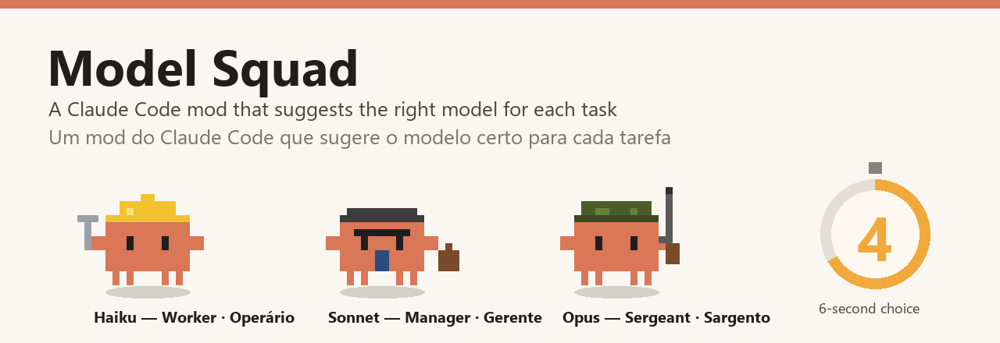
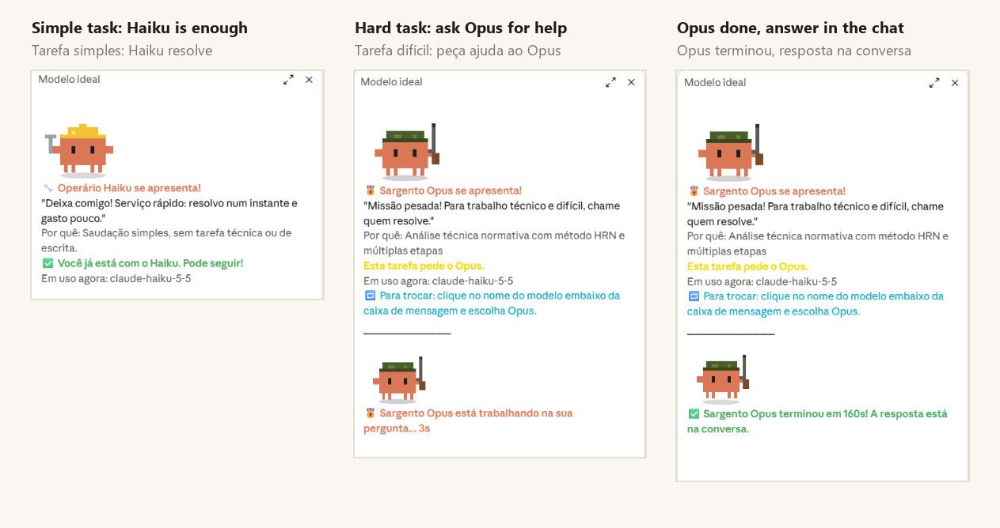

<p align="center"></p>

<p align="center">
<b>English</b> · <a href="#português">Português</a>
</p>

# Model Squad

A **mod for Claude Code** (desktop app Code tab and terminal) that watches every request you send and tells you, in a side panel, which Claude model fits the task best — with a pixel-art squad:

| | Character | Best for |
|---|---|---|
| 🔧 | **Haiku the Worker** | quick questions, checking a fact, short summaries |
| 💼 | **Sonnet the Manager** | everyday work: emails, texts, proposals, research |
| 🎖️ | **Sergeant Opus** | technical analysis, standards, code, hard multi-step tasks |

<p align="center"></p>

## What it does

- **Judges every request** (in context with your last 3) and shows the right character in the panel. Short replies like "ok" or "yes" keep the current suggestion.
- **Saves money:** when a cheaper model is enough, it tells you so.
- **Holds hard questions for 6 seconds.** If the task needs a stronger model than the one you're using, the question is held before it reaches the model, and a countdown clock appears next to the character. You choose:
  - 🆘 **Ask for help (just this once):** the stronger model answers this one question; the conversation stays on the cheaper model.
  - 🔁 **I'll switch:** pauses the countdown; switch in the model picker and click "Send again".
  - ▶️ **Carry on:** sends it to the current model right away.
  - No click? After 6 seconds the current model carries on by itself.
- **Speaks your language:** Portuguese, English or Spanish, following what you write.

## Install

In a terminal, start Claude Code (`claude`) and type:

```
/plugin install model-squad --marketplace herlonventura/claude-model-squad
```

Answer `y` to add the marketplace, then pick the **user** scope. The panel opens on the next session; `/model-squad` reopens it. A mod installed at the user scope also loads in the desktop app's Code tab.

## Good to know

- **Cost:** each request is judged by Haiku (a fraction of a cent). The optional helper runs the stronger model once.
- **Switching models in the desktop app** is done in the model picker below the message box; the panel tells you exactly where to click.
- **The helper gives a second opinion but cannot open files.** For long technical work with files, switch models instead.
- When a question is held, Claude Code shows a notice "a hook blocked your prompt" — that is the hold working.
- Mods are an **early-access** Claude Code feature; the API may change between releases.

## License and credits

MIT. Community project, **unofficial — not affiliated with or endorsed by Anthropic**. Claude, Haiku, Sonnet and Opus are names of Anthropic models. Made by Herlon ([VHE Engenharia](https://vheengenharia.com.br)), Brazil, with Claude.

---

## Português

Um **mod para o Claude Code** (aba Code do app e terminal) que avalia cada pedido que você envia e mostra, num painel ao lado, qual modelo do Claude é o melhor para a tarefa, com uma equipe em pixel art:

| | Personagem | Melhor para |
|---|---|---|
| 🔧 | **Operário Haiku** | perguntas rápidas, conferir um dado, resumos curtos |
| 💼 | **Gerente Sonnet** | dia a dia: e-mails, textos, propostas, pesquisas |
| 🎖️ | **Sargento Opus** | análises técnicas, normas, programação, tarefas difíceis |

### O que ele faz

- **Avalia cada pedido** (com o contexto dos 3 anteriores) e mostra o personagem certo no painel. Respostas curtas como "ok" ou "sim" mantêm a sugestão.
- **Economiza:** quando um modelo mais barato basta, ele avisa.
- **Segura perguntas difíceis por 6 segundos.** Se a tarefa pede um modelo mais forte que o atual, a pergunta é segurada antes de chegar ao modelo e aparece um reloginho ao lado do personagem. Você escolhe:
  - 🆘 **Pedir ajuda (só esta vez):** o modelo mais forte responde só esta pergunta; a conversa continua no mais barato.
  - 🔁 **Vou mudar:** para a contagem; troque no seletor de modelo e clique em "Enviar de novo".
  - ▶️ **Seguir:** envia na hora para o modelo atual.
  - Sem clique, depois de 6 segundos o modelo atual segue sozinho.
- **Fala o seu idioma:** português, inglês ou espanhol, conforme o que você escreve.

### Instalação

No terminal, abra o Claude Code (`claude`) e digite:

```
/plugin install model-squad --marketplace herlonventura/claude-model-squad
```

Responda `y` para adicionar o marketplace e escolha o escopo **user**. O painel abre na próxima sessão; `/model-squad` reabre. Instalado no escopo user, ele também carrega na aba Code do app.

### Bom saber

- **Custo:** cada pedido é avaliado pelo Haiku (fração de centavo). O ajudante opcional usa o modelo mais forte uma vez.
- **No app, a troca de modelo** é feita no seletor embaixo da caixa de mensagem; o painel diz onde clicar.
- **O ajudante dá uma segunda opinião, mas não abre arquivos.** Para trabalho técnico longo com arquivos, mude de modelo.
- Quando uma pergunta é segurada, o Claude Code mostra o aviso "um hook bloqueou seu prompt": é a espera funcionando.
- Mods são um recurso em **acesso antecipado** do Claude Code; a API pode mudar entre versões.

Licença MIT. Projeto da comunidade, **não oficial, sem vínculo com a Anthropic**.
